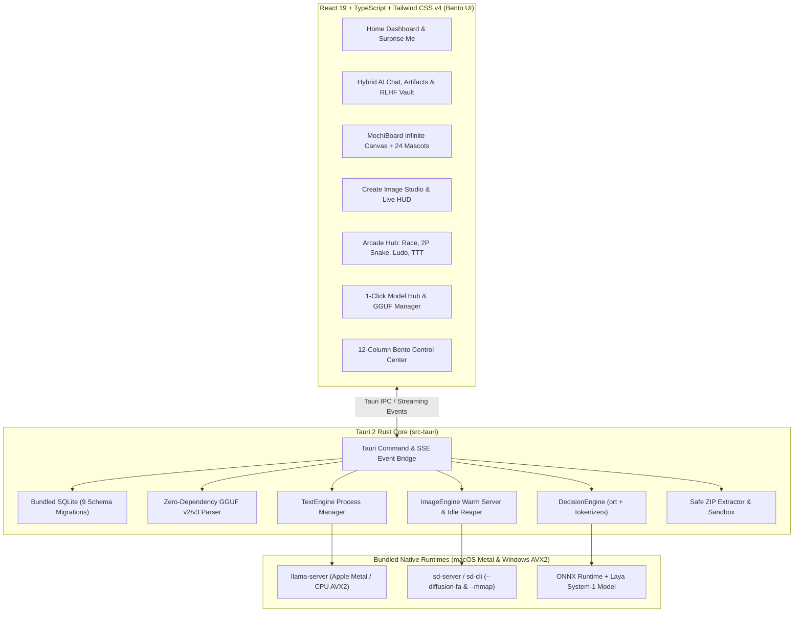

<div align="center">


# Second Brain (`2nd Brain` • v0.4.0)

### **The Autonomous, Local-First AI Desktop Studio, Infinite Ideation Canvas, Image Generation Engine & Arcade Companion**

*Built for **macOS (Apple Silicon M1/M2/M3/M4 & Intel)** and **Windows** with **Tauri 2**, **React 19**, **TypeScript**, **Tailwind CSS v4**, and **Rust** — zero external dependencies, zero monthly fees.*

[](https://github.com/Jerry4539/second-brain/actions/workflows/release.yml)
[](https://github.com/Jerry4539/second-brain/releases)
[](https://github.com/Jerry4539/second-brain/stargazers)
[](https://github.com/Jerry4539/second-brain/network/members)
[](https://github.com/Jerry4539/second-brain/issues)
[](./CONTRIBUTING.md)
[](./LICENSE)

[](https://github.com/Jerry4539/second-brain/releases)
[](https://v2.tauri.app/)
[](https://www.rust-lang.org/)
[](https://react.dev/)
[](https://www.typescriptlang.org/)
[](https://tailwindcss.com/)
[](https://www.sqlite.org/)
[](https://github.com/ggml-org/llama.cpp)
[](https://github.com/leejet/stable-diffusion.cpp)
[](https://onnxruntime.ai/)

[**⬇ Download Installers (.dmg / .exe)**](https://github.com/Jerry4539/second-brain/releases) •
[**✨ What's New in v0.4.0**](#-whats-new-in-v040) •
[**🏗️ Architecture**](#️-system-architecture) •
[**🚀 Quick Start**](#-quick-start-macos--windows) •
[**🤝 Collaborate & Contribute**](#-collaborate--contribute)

</div>

---

> **Zero External End-User Dependencies:** The packaged desktop app runs completely standalone. End users **never** need to install Python, Node.js, Rust, Docker, or CUDA — everything from SQLite to Apple Silicon Metal GPU & Windows AVX2 CPU inference runtimes (`llama-server`, `sd-server` / `sd-cli`, and `onnxruntime`) is bundled and managed directly inside the app.

---

## ✨ What's New in v0.4.0

- **🎨 Infinite Studio Canvas & Bottom-Right Mascot Co-Pilot (`CanvasPage`)**
  - **Infinite Board & Project Workspace:** Organize work into **Projects → Folders → Multi-Sheet Boards** with dot/cross/heart/sparkle grids, smooth trackpad pan/zoom, custom name-tagged cursor (`Jerry` pointer + grab hand), and one-click **PNG / PDF / Word** export.
  - **Rich Ideation & Wireframing Kits:** Drag-and-drop or AI-generate mobile & desktop **Wireframes** (Nav bars, Tab bars, Cards, Hero sections, Pricing, Stats, Footers), **Flowcharts**, **Journey Maps**, **Sitemaps**, **Mind Maps**, sticky notes, rich docs, tables, checklists, voice memos, video cards, and vector/freehand drawings.
  - **Contextual Selection Bar:** Selecting any element dynamically adapts the bottom bar with alignment, distribution, grouping/ungrouping, section creation, drop shadows, masking, cropping, and color palette extraction.
  - **Bottom-Right Second Brain Mascot & Popup Chat:** Interactive 24-character eye-tracking mascot (`page-mascot`) pinned to the bottom-right corner. Ask Second Brain to build custom dark/light mobile screens, landing pages, flowcharts, or group and rewrite cards on your board.
  - **In-Canvas AI Image Rendering:** Requesting an image on the Canvas spawns an animated in-canvas generation card right on the board and resolves directly into an editable image card.
- **🎛️ Sleek 12-Column Bento Control Center (`SettingsPage`)**
  - Responsive Bento-grid settings workspace with category filter pills (*All Bento Cards*, *Image Rendering & Models*, *Canvas & Mascot*, *Knowledge & Web APIs*, *Memory, RLHF & Hardware*).
  - **Configurable Diffusion Rendering Steps:** One-tap preset pills (`4`, `5`, `6`, `7`, `8`, `10`, `12`, `16`, `20` steps) + custom slider (`2–30` steps), default render resolution (`384×384`, `512×512`, `768×768`), CFG guidance scale (`1.0`, `1.8`, `5.0`, `7.0`), and sampling scheduler (`LCM`, `Euler Ancestral`, `DPM++ 2M`) synced across both **Create Studio** and **Canvas**.
- **📦 Practical High-Capability Curated Models (`ModelsPage`)**
  - Upgraded curated catalog with practical, high-reasoning GGUF models (*Qwen 2.5 7B Instruct*, *Meta Llama 3.1 8B Instruct*, *DeepSeek R1 Distill Qwen 7B*, *Qwen 2.5 Coder 7B*, *Gemma 2 9B*, *Qwen 2.5 3B*) and fast Diffusion checkpoints (*LCM DreamShaper v7*, *SDXL-Turbo*, *DreamShaper 8*).
- **🧠 Autonomous Hybrid Knowledge Router, RLHF & Memory Vault (`ChatPage`)**
  - **Smart Hybrid Knowledge Router:** Automatically fuses local LLM reasoning with live web context (Wikipedia, DuckDuckGo, Hacker News, Google Custom Search API), TMDB Movies & TV intelligence, and Open-Meteo weather telemetry.
  - **Reinforcement Reward Learning (RLHF) & Episodic Memory Vault:** Learns from explicit (`👍` +10 XP) and implicit rewards to adapt response formatting and remembers permanent facts across conversations.

---

## 🧩 Core Modules

| Module | Highlights |
|---|---|
| **AI Chat & Artifacts** | Multi-turn streaming SSE chat (`llama.cpp`), Claude-style structured reasoning, interactive side-panel code/doc artifacts, inline image generation (`ChatImageCard`), and hybrid web search (`/web`, `/tmdb`, `/save`). |
| **Infinite Canvas** | Projects & folders, wireframing & flowchart kits, contextual object toolbar, group/ungroup, masking, PNG/PDF/Word export, and bottom-right **Second Brain** 8-way eye-tracking mascot co-pilot. |
| **Create Image Studio** | Local `stable-diffusion.cpp` engine with Metal Flash Attention (`--diffusion-fa`) & `--mmap`, configurable **4–20 rendering steps** (`6`, `7`, `8` LCM sweet-spot presets), resolution & CFG controls, and gallery history. |
| **Curated Model Hub** | One-click HuggingFace downloader with live byte progress + local `.gguf` / `.safetensors` / `.ckpt` importer with zero-dependency Rust GGUF v2/v3 metadata parsing. |
| **Arcade & Add-ons** | Built-in **Apex Nitro: Multi-Track Grand Prix** (`CarRaceBoard`), **Cyber Serpents: 2-Player Snake** (`SnakeDualBoard`), **15×15 Ludo Grand Arena**, **Tactical Tic-Tac-Toe** (Minimax AI), and sandboxed `.zip` add-on runner. |
| **Bento Settings** | Responsive 12-column Bento Control Center for Image Rendering steps, LLM/Diffusion defaults, Canvas physics, RLHF policy weights, API connectors, and Apple Silicon / Windows RAM management. |

---

## 🏗️ System Architecture



---

## 🛠️ Tech Stack

| Layer | Technology |
|---|---|
| **Desktop Shell & Backend** | [Tauri 2](https://v2.tauri.app/) (Rust 2021, Tokio, Reqwest, `sysinfo`) |
| **Frontend UI** | React 19, TypeScript, Vite 8, Tailwind CSS v4, Lucide Icons, React Router v7 |
| **Infinite Canvas** | Custom HTML5 / SVG / TipTap / WebAudio Infinite Board Engine + `page-mascot` WebGL/2D eye-tracking mascot |
| **Database** | Bundled SQLite via `tauri-plugin-sql` (9 sequential schema migrations) |
| **Text Inference** | `llama.cpp` (`llama-server` Apple Silicon Metal / CPU AVX2 sidecar over local HTTP SSE) |
| **Image Inference** | `stable-diffusion.cpp` (`sd-server` / `sd-cli` with `--diffusion-fa` Metal Flash Attention & `--mmap`) |
| **Decision Engine** | ONNX Runtime (`ort` crate) + `tokenizers` (`Laya` mmBERT-base ONNX + deterministic fallback) |

---

## 🚀 Quick Start (macOS & Windows)

### 1. Clone & Install Dependencies

```bash
git clone https://github.com/Jerry4539/second-brain.git
cd second-brain
npm install
```

### 2. Fetch Native Inference Runtimes (One-Time Setup)

#### On macOS (Apple Silicon M1/M2/M3/M4 & Intel):

```bash
npm run setup:mac
```

#### On Windows (PowerShell):

```powershell
powershell -ExecutionPolicy Bypass -File scripts/fetch-llama-server.ps1
powershell -ExecutionPolicy Bypass -File scripts/fetch-sd.ps1
powershell -ExecutionPolicy Bypass -File scripts/fetch-onnxruntime.ps1
```

### 3. Run in Development Mode

```bash
npm run tauri dev
```

### 4. Build the Standalone Desktop App

```bash
# Build macOS .app bundle:
npx tauri build --bundles app

# Or build full platform installers (.dmg / .exe):
npm run tauri build
```

#### Built Application Outputs:
- **macOS `.app` / `.dmg`:** `src-tauri/target/release/bundle/macos/Second Brain.app` & `bundle/dmg/`
- **Windows NSIS Installer (`.exe`):** `src-tauri/target/release/bundle/nsis/`

---

## 📂 Project Structure

```text
second-brain/
├── .github/
│   ├── ISSUE_TEMPLATE/            # Structured bug report & feature/collab templates
│   ├── workflows/release.yml      # Automated Windows (.exe) & macOS (.dmg) release CI/CD
│   └── PULL_REQUEST_TEMPLATE.md   # Contributor PR checklist
├── docs/                          # Product spec, architecture handoff, progress & changelog
├── public/
│   ├── mascots/                   # 24 mascot directional & reaction sprite sheets (.webp)
│   └── mochiboard/                # Infinite Canvas engine, wireframe kits, templates & styles
├── scripts/                       # macOS (.sh) & Windows (.ps1) runtime fetchers
├── src/
│   ├── components/                # Chat, Create HUD, Games, Layout, and Bento UI primitives
│   ├── lib/                       # Agent orchestrator, Canvas AI bridge, SQLite CRUD, curated models
│   └── pages/                     # Home, Chat, Create, Canvas, Play, Library, Models, Addons, Settings
└── src-tauri/                     # Rust backend (llama.cpp, stable-diffusion.cpp, GGUF, ONNX, SQLite)
```

---

## 🤝 Collaborate & Contribute

We are actively looking for **collaborators, Rust/Tauri engineers, React/Canvas designers, and local-AI hackers** to join the **Second Brain** project!

### High-Impact Collaboration Tracks
- 🎨 **Infinite Canvas Kits & Templates (`public/mochiboard/`):** Contribute new wireframe components, UI kits, architecture diagrams, or smart mascot co-pilot skills.
- ⚡ **Local Inference & Hardware Acceleration (`src-tauri/src/`):** Help add Vulkan/CUDA GPU profiles on Windows/Linux alongside our Apple Silicon Metal and AVX2 CPU runtimes.
- 🕹️ **New Offline Arcade Games & Add-ons (`src/components/games/`):** Create new 60 FPS multiplayer or AI-driven mini-games with procedural Web Audio effects.
- 🧠 **Agent Tools & Hybrid Knowledge Connectors (`src/lib/`):** Expand our local RAG, episodic memory vault, and zero-key public knowledge connectors.

### How to Jump In
1. Check out our [**Contributing Guide (`CONTRIBUTING.md`)**](./CONTRIBUTING.md).
2. Browse [**Open Issues**](https://github.com/Jerry4539/second-brain/issues) or propose a new feature using our [**Feature / Collab Template**](https://github.com/Jerry4539/second-brain/issues/new/choose).
3. Fork the repo, create a branch (`git checkout -b feat/your-feature`), and open a Pull Request!

[](https://github.com/Jerry4539/second-brain/issues/new/choose)
[](https://github.com/Jerry4539/second-brain/fork)

---

## 📚 Documentation

- **[Product Specification (`docs/ALL-i-want.md`)](./docs/ALL-i-want.md)**
- **[Engineering Handoff & Architecture (`docs/AGENT_HANDOFF.md`)](./docs/AGENT_HANDOFF.md)**
- **[Implementation Progress (`docs/PROGRESS.md`)](./docs/PROGRESS.md)**
- **[Changelog (`docs/CHANGELOG.md`)](./docs/CHANGELOG.md)**
- **[Contributing Guide (`CONTRIBUTING.md`)](./CONTRIBUTING.md)**

---

## ⭐ Support & Make This Repo Popular!

If you enjoy **Second Brain** or believe in **100% private, offline-first local AI**, please:
1. **Star ⭐ this repository** at the top right of the page!
2. **Share it** on X/Twitter, Reddit (`r/LocalLLaMA`, `r/tauri`, `r/rust`, `r/reactjs`), Hacker News, and Product Hunt.
3. **Tag a friend** who loves building with local LLMs, diffusion models, or infinite canvases!

[](https://github.com/Jerry4539/second-brain/stargazers)

---

## 📄 License

Distributed under the **MIT License**. See [`LICENSE`](./LICENSE) for full details.
